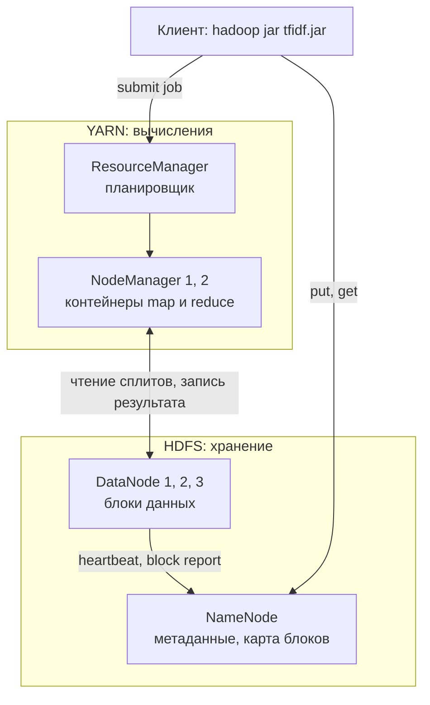
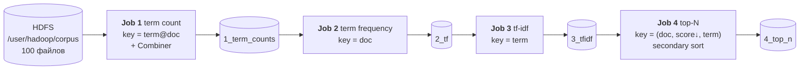
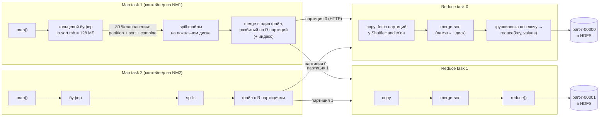
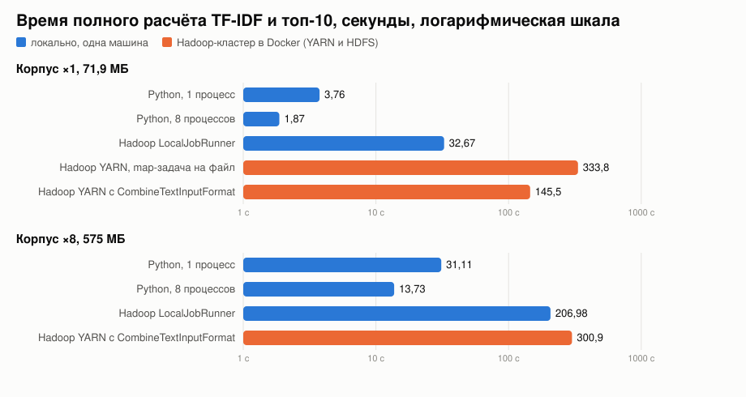
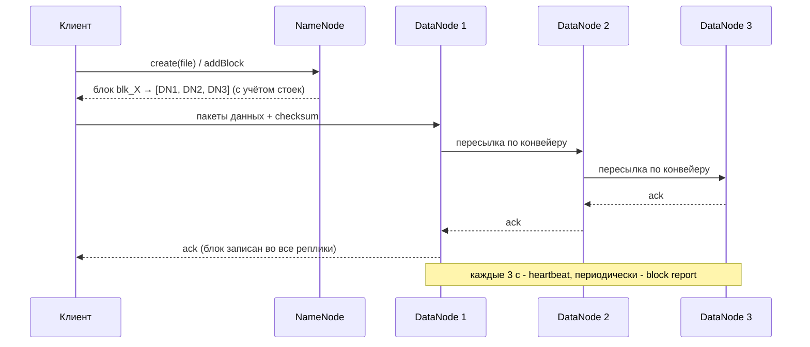

# ДЗ №2. Hadoop MapReduce: TF-IDF и топ-N слов

| | |
|---|---|
| Алгоритм | TF-IDF и топ-10 терминов на документ. 4 MapReduce-задачи: Combiner, in-mapper combining, secondary sort |
| Данные | 100 книг Gutenberg: 71,9 МБ, 12,5 млн токенов, 116 788 терминов, 879 659 пар (t, d), ×8 - 575 МБ |
| Кластер | Hadoop 3.4.1, Docker: NameNode и 3 DataNode, ResourceManager и 2 NodeManager |
| Корректность | Hadoop совпадает с Python: 879 659 из 879 659 значений, максимальное расхождение 0, топ-10 совпадает для всех книг (×1 и ×8) |
| Время ×1 | Python 3,76 с, LocalJobRunner 32,67 с, YARN 145,5 с (CombineTextInputFormat) или 333,8 с (map-задача на файл) |
| Время ×8 | Python 31,11 с (рост в 8,3 раза), YARN 300,9 с (рост в 2,1 раза) |
| Shuffle | Combiner в Job 1 сокращает передачу в 7,5 раза (с 12,5 млн до 1,66 млн пар), in-mapper top-N в Job 4 в 220 раз |
| HDFS | Отказ DataNode: обнаружен за 59 с, чтение без ошибок (md5 совпадает), ре-репликация за 64 с |

## Содержание

1. [Данные](#1-данные)
2. [Задача](#2-задача)
3. [Окружение](#3-окружение)
4. [MapReduce-решение](#4-mapreduce-решение)
5. [Shuffle и Sort](#5-shuffle-и-sort)
6. [Запуск](#6-запуск)
7. [Результаты](#7-результаты)
8. [Сравнение с локальной реализацией](#8-сравнение-с-локальной-реализацией)
9. [HDFS: надёжность и масштабируемость](#9-hdfs-надёжность-и-масштабируемость)
10. [Выводы](#10-выводы)

---

## 1. Данные

Источник: Project Gutenberg.

| Параметр | Значение |
|---|---|
| Документов, D | 100 (один файл - одна книга) |
| Объём | 71,9 МБ, 1 550 075 строк |
| Размер книги | 18 КБ (*The Yellow Wallpaper*) - 5,4 МБ (*Complete Works of Shakespeare*), медиана 561 КБ |
| Токенов | 12 547 131 |
| Уникальных терминов | 116 788 |
| Пар (термин, документ) | 879 659 |

| Корпус | Путь | Назначение |
|---|---|---|
| Основной | `data/corpus` | все эксперименты |
| ×8 | `data/corpus_x8` | 800 файлов, 575 МБ (hard links), замер масштабирования |
| Игрушечный | `data/toy` | 3 документа, трассировка пар (key, value) |

```text
d1.txt: the cat sat on the mat
        the cat ate the fish
d2.txt: the dog sat on the log
d3.txt: cat and dog are friends
```

Токенизация (одинакова в `Tokenizer.java` и `tfidf_local.py`):

1. lowercase
2. строки с не-ASCII: NFD и удаление диакритики (`Rostóv` становится `rostov`)
3. токен - `[a-z]+`, длина не меньше 2

## 2. Задача

```text
tf(t, d)     = n(t, d) / N(d)
idf(t)       = ln( D / df(t) )
tf-idf(t, d) = tf(t, d) · idf(t)
```

- n(t, d) - число вхождений *t* в *d*
- N(d) - длина *d* в токенах
- df(t) - число документов с *t*
- выход: топ-10 терминов каждого документа по TF-IDF.

Каждой величине нужна своя группировка. Одна задача MapReduce даёт одну группировку (Shuffle), поэтому нужна цепочка из 4 задач:

| Величина | Группировка | Задача |
|---|---|---|
| n(t, d) | (t, d) | Job 1 |
| N(d) | d | Job 2 |
| df(t) | t | Job 3 |
| топ-N | d с сортировкой по score | Job 4 |

## 3. Окружение



| Параметр | Значение |
|---|---|
| `dfs.replication` | 3 |
| `dfs.blocksize` | 32 МБ |
| `dfs.heartbeat.interval` и `recheck-interval` | 3 с и 15 с |
| `yarn.nodemanager.resource.memory-mb` | 2304 МБ |
| `mapreduce.{map,reduce}.memory.mb` | 768 МБ (heap 600 МБ) |
| `mapreduce.task.io.sort.mb` | 128 МБ |
| `mapreduce.job.reduce.slowstart.completedmaps` | 0,95 |
| `yarn.nodemanager.aux-services` | `mapreduce_shuffle` |

Стенд: MacBook Apple Silicon, 8 ядер, VM colima 4 vCPU и 8 ГБ, образ amd64 под эмуляцией Rosetta. Все 7 демонов на одной машине: механика кластера (репликация, YARN, сетевой shuffle) полная, выигрыша от нескольких машин нет.

## 4. MapReduce-решение



| Job | Mapper: вход и выход | Reducer: вход и выход | Группировка Shuffle |
|---|---|---|---|
| 1 | `(offset, line)` в `(t@d, 1)` | `(t@d, [1,1,…])` в `(t@d, n)` | (t, d) |
| 2 | `(t@d, n)` в `(d, "t=n")` | `(d, ["t=n",…])` в `(t@d, "n/N(d)")` | d, даёт N(d) |
| 3 | `(t@d, "n/N")` в `(t, "d=n/N")` | `(t, ["d=n/N",…])` в `(t@d, tf·idf)` | t, даёт df(t) |
| 4 | `(t@d, score)` в `((d, score, t), t)` | `(d, [t₁, t₂, …])` по убыванию score, выход: первые N | d, значения отсортированы по score |

Драйвер `TfIdfDriver`:
- запускает задачи последовательно (выход Job k становится входом Job k+1)
- D равно `FileSystem.listStatus(input).length`, передаётся в Job 3 через `Configuration` (`tfidf.num.docs`).

### 4.1 Job 1 - число вхождений термина в документ

| Компонент | Действие |
|---|---|
| Mapper | вход `TextInputFormat`, doc из `FileSplit.getPath()` (для `CombineTextInputFormat` - из `mapreduce.map.input.file`), выход `(t@d, 1)` на токен |
| Combiner | `SumReducer`, сумма ассоциативна и коммутативна, поэтому допустим на map-стороне |
| Reducer | сумма частичных сумм от всех map-задач |

```text
вход map:      (0, "the cat sat on the mat")  (23, "the cat ate the fish")
выход map:     (the@d1.txt,1) (cat@d1.txt,1) (sat@d1.txt,1) (on@d1.txt,1) (the@d1.txt,1) (mat@d1.txt,1)
               (the@d1.txt,1) (cat@d1.txt,1) (ate@d1.txt,1) (the@d1.txt,1) (fish@d1.txt,1)      11 пар
после combine: (the@d1.txt,4) (cat@d1.txt,2) (sat@d1.txt,1) (on@d1.txt,1) (mat@d1.txt,1)
               (ate@d1.txt,1) (fish@d1.txt,1)                                                     7 пар
```

```text
part-r-00000: are@d3.txt 1 | ate@d1.txt 1 | cat@d1.txt 2 | cat@d3.txt 1 | dog@d3.txt 1 | ... | the@d2.txt 2
part-r-00001: and@d3.txt 1 | dog@d2.txt 1 | friends@d3.txt 1 | log@d2.txt 1 | on@d1.txt 1 | sat@d2.txt 1 | the@d1.txt 4
```

Ключи отсортированы внутри файла (Sort), распределены по файлам Partitioner'ом (§5.4).

### 4.2 Job 2 - длина документа и tf

| Компонент | Действие |
|---|---|
| Mapper | вход `KeyValueTextInputFormat`, doc идёт в ключ, `t=n` в значение |
| Reducer | все термины документа, N(d) - сумма n, выход `(t@d, n/N(d))` |

```text
вход reduce:  (d1.txt, [the=4, on=1, sat=1, mat=1, fish=1, cat=2, ate=1])     N_d1 = 11
выход:        (the@d1.txt, 4/11) (on@d1.txt, 1/11) ... (cat@d1.txt, 2/11)
вход reduce:  (d2.txt, [the=2, on=1, sat=1, log=1, dog=1])                     N_d2 = 6
вход reduce:  (d3.txt, [dog=1, cat=1, are=1, friends=1, and=1])                N_d3 = 5
```

Реальный корпус: `reduce_groups = 100` (по группе на книгу).

### 4.3 Job 3 - df и TF-IDF

| Компонент | Действие |
|---|---|
| Mapper | t идёт в ключ, `d=tf` в значение |
| Reducer | df(t) - размер группы, idf = ln(D/df), выход `(t@d, tf·idf)` |

```text
вход reduce:  (the, [d1.txt=4/11, d2.txt=2/6])      df=2  idf=ln(3/2)=0.4055
выход:        (the@d1.txt, 0.14744185749387798)  (the@d2.txt, 0.13515503603605478)
вход reduce:  (log, [d2.txt=1/6])                    df=1  idf=ln 3=1.0986
выход:        (log@d2.txt, 0.1831020481113516)
```

Реальный корпус: `reduce_groups = 116 788` (по группе на термин).

### 4.4 Job 4 - топ-N (secondary sort)

| Компонент | Класс | Действие |
|---|---|---|
| Составной ключ | `DocScoreKey(doc, score, term)` | сортировка: doc по возрастанию, score по убыванию, term по возрастанию |
| Partitioner | `DocPartitioner` | `hash(doc) % R`: документ целиком у одного reducer'а |
| Grouping comparator | `DocGroupingComparator` | сравнивает только doc, поэтому один `reduce()` на документ |
| Mapper | `TopNMapper` | in-mapper combining: min-куча размера N на документ |
| Reducer | `TopNReducer` | значения уже по убыванию score, reducer берёт первые N |

```text
map (d1.txt):   ((d1.txt, 0.1474, the), the)  ((d1.txt, 0.0999, ate), ate)  ((d1.txt, 0.0999, fish), fish)  ...
sort:           d1.txt: the(0.1474) > ate(0.0999) = fish(0.0999) = mat(0.0999) > cat(0.0737) > ...
reduce(d1.txt): 1 the 0.1474 | 2 ate 0.0999 | 3 fish 0.0999
```

Реальный корпус:
- выход map: с 879 659 до 4 000 пар (по 10 кандидатов на каждый из 100 документов в каждом из 4 сплитов)
- shuffle: 255 КБ, в 220 раз меньше
- сортировку выполняет фреймворк (внешняя merge-сортировка), поэтому reducer не держит документ в памяти.

`the` на игрушечном корпусе: idf больше нуля (нет в d3). На реальном: df равно 100, idf равно 0, поэтому стоп-слова отсекаются без списка.

## 5. Shuffle и Sort

### 5.1 Определение

- **Shuffle** - передача выхода map-задач reducer'ам.
- **Sort** - сортировка и слияние по ключу.
- Результат: все значения ключа *k* - в одном вызове `reduce(k, values)`, ключи приходят упорядоченными.
- Стоимость: диск, сеть, сериализация. В этой цепочке - 139,8 МБ по сети и 6,07 млн spilled records (§5.6).



### 5.2 Map-сторона

| Шаг | Действие | Параметры |
|---|---|---|
| 1. Буфер | `context.write` сериализует пару в кольцевой буфер, Partitioner вычисляет номер партиции | `io.sort.mb` 128 МБ, по умолчанию `(hashCode & MAX_INT) % R`, Job 4 - `DocPartitioner` |
| 2. Spill | при заполнении на 80 %: сортировка по (партиция, ключ), затем Combiner, затем запись spill-файла на локальный диск (не HDFS) | `io.sort.spill.percent` 0,8 |
| 3. Merge | слияние spill-файлов в один файл с R отсортированными партициями и индексом, при 3 и более spill - повторный Combiner, отдаётся через `ShuffleHandler` NM | `io.sort.factor` 10 |

### 5.3 Reduce-сторона

| Шаг | Действие |
|---|---|
| 1. Copy | список готовых map'ов от AM (`MapCompletionEvents`), HTTP-fetch своей партиции у каждого map'а, 5 потоков, старт до завершения всех map'ов (`slowstart`) |
| 2. Merge | куски уже отсортированы, поэтому нужно только слияние, память, при нехватке - диск, финальный проход идёт прямо в `reduce()` |
| 3. Group | соседние ключи, равные по grouping comparator, образуют одну группу, итератор ленивый, группа не обязана помещаться в память |

Гарантии:
1. пара с ключом *k* попадает ровно к одному reducer'у `partition(k)`
2. ключи внутри reducer'а упорядочены
3. порядок значений в группе не гарантирован без secondary sort (Job 2: `the=4` раньше `cat=2`).

### 5.4 Трассировка: Job 1, игрушечный корпус, 2 reducer'а

`scripts/shuffle_trace.py` воспроизводит `HashPartitioner` (`Text.hashCode` через `WritableComparator.hashBytes`). Вывод совпал с `part-r-00000` и `part-r-00001` кластера. Полный вывод: `results/shuffle_trace_toy.md`.

| Mapper (сплит) | Партиция 0 (Reducer 0) | Партиция 1 (Reducer 1) |
|---|---|---|
| 0 (`d1.txt`, 11 пар, после combine 7) | `(ate@d1,1) (cat@d1,2) (fish@d1,1) (mat@d1,1) (sat@d1,1)` | `(on@d1,1) (the@d1,4)` |
| 1 (`d2.txt`, 6 пар, после combine 5) | `(on@d2,1) (the@d2,2)` | `(dog@d2,1) (log@d2,1) (sat@d2,1)` |
| 2 (`d3.txt`, 5 пар, после combine 5) | `(are@d3,1) (cat@d3,1) (dog@d3,1)` | `(and@d3,1) (friends@d3,1)` |

- Reducer 0: fetch партиции 0 у 3 mapper'ов (10 пар), merge в порядке `are@d3 < ate@d1 < cat@d1 < cat@d3 < dog@d3 < fish@d1 < mat@d1 < on@d2 < sat@d1 < the@d2`, затем 10 вызовов `reduce()`.
- Reducer 1: 7 пар.
- Счётчики: `map_out=22`, `combine_out=17`, `reduce_groups=17`.
- Job 3: `(cat, d1.txt=2/11)` из сплита d1 и `(cat, d3.txt=1/5)` из сплита d3 попадают в один `reduce("cat", [d1.txt=2/11, d3.txt=1/5])`, отсюда df(cat) равно 2.

### 5.5 Роль Shuffle/Sort по задачам

| Job | Ключ | Без Shuffle невозможно |
|---|---|---|
| 1 | `term@doc` | сложить вхождения, если документ разбит на несколько сплитов |
| 2 | `doc` | получить N(d): термины документа разбросаны по партициям Job 1 |
| 3 | `term` | получить df(t): документы термина в разных mapper'ах |
| 4 | `(doc, score, term)`, score по убыванию | получить термины документа по убыванию score без сортировки в памяти |

### 5.6 Стоимость Shuffle на реальном корпусе

`CombineTextInputFormat`, 4 reducer'а:

| Job | Выход map | После Combiner или in-mapper | Shuffle | Групп | Spilled records |
|---|---:|---:|---:|---:|---:|
| 1 term count | 12 547 131 | 1 664 003, на входе reduce 879 659 | 45,7 МБ | 879 659 | 2 543 662 |
| 2 tf | 879 659 | - | 44,0 МБ | 100 | 1 759 318 |
| 3 tf-idf | 879 659 | - | 49,9 МБ | 116 788 | 1 759 318 |
| 4 top-N | 879 659 (вход) | 4 000 | 0,26 МБ | 100 | 8 000 |

- Job 1: `Shuffled Maps = 8`: 2 map-задачи на 4 reducer'а.
- Job 1: `Combine input records` 13,3 млн больше, чем `Map output records` 12,5 млн - Combiner вызван и при spill, и при merge.
- Combiner Job 1: пар в сети в 7,5 раза меньше.
- Jobs 2, 3: Combiner неприменим (нужны все значения группы): shuffle 44,0 и 49,9 МБ.
- Суммарный shuffle цепочки 139,8 МБ, примерно два объёма корпуса (71,9 МБ).
- Job 4: в 220 раз меньше.
- `spilled_records` не меньше `map_out`: каждая пара пишется на диск на map- и на reduce-стороне.

## 6. Запуск

```bash
docker compose up -d
docker compose exec namenode hdfs dfsadmin -report | grep "Live datanodes"

./build.sh

scripts/run_hadoop.sh data/corpus corpus_combine 4 10 64

python3 local/tfidf_local.py data/corpus results/local_x1
python3 scripts/compare.py results/hadoop_corpus_combine results/local_x1
```

`results/hadoop_corpus_combine/job.log`:

```text
Documents: 100, reducers: 4, top-N: 10, combine.mb: 64
INFO  JobSubmitter - number of splits:2
INFO  YarnClientImpl - Submitted application application_1791032284741_0001
INFO  Job - Running job: job_1791032284741_0001
INFO  Job -  map 0% reduce 0%
INFO  Job -  map 100% reduce 0%
INFO  Job -  map 100% reduce 100%
INFO  Job - Job job_1791032284741_0001 completed successfully
        Launched map tasks=3
        Rack-local map tasks=2
        Map output records=12547131
        Combine output records=1664003
        Reduce input records=879659
        Shuffled Maps =8
        Merged Map outputs=8
        Spilled Records=2543662
...
=== TF-IDF pipeline summary ===
STAGE tfidf-1-term-count         48.17s  maps=3  reduces=4 map_out=12547131 combine_out=1664003 shuffle_bytes=45660149 reduce_groups=879659
STAGE tfidf-2-term-frequency     32.39s  maps=4  reduces=4 map_out=879659   shuffle_bytes=44042944 reduce_groups=100
STAGE tfidf-3-tfidf              35.24s  maps=4  reduces=4 map_out=879659   shuffle_bytes=49870402 reduce_groups=116788
STAGE tfidf-4-top-n              29.58s  maps=4  reduces=2 map_out=4000     shuffle_bytes=255296   reduce_groups=100
TOTAL_SECONDS 145.45
```

Web UI: YARN `http://localhost:8088`, HDFS `http://localhost:9870`.

## 7. Результаты

Полный вывод: `results/hadoop_corpus_combine/4_top_n/part-r-00000`.

| Книга | Топ-10 по TF-IDF |
|---|---|
| Pride and Prejudice | darcy, bingley, bennet, wickham, elizabeth, collins, lydia, longbourn, jane, netherfield |
| Moby Dick | whale, ahab, stubb, queequeg, starbuck, pequod, sperm, whales, whaling, moby |
| Alice's Adventures in Wonderland | alice, gryphon, hatter, dormouse, turtle, caterpillar, rabbit, duchess, dinah, mock |
| War and Peace | natasha, pierre, rostov, kutuzov, sonya, denisov, moscow, dolokhov, andrew, petya |
| Frankenstein | clerval, justine, felix, safie, elizabeth, frankenstein, geneva, ingolstadt, kirwin, agatha |
| Dracula | helsing, mina, lucy, harker, seward, jonathan, van, godalming, quincey, renfield |
| The Adventures of Sherlock Holmes | holmes, sherlock, lestrade, rucastle, watson, mccarthy, hosmer, roylott, windibank, stoner |
| The Great Gatsby | gatsby, daisy, jordan, tom, wolfshiem, wilson, michaelis, mckee, buchanan, garage |
| A Tale of Two Cities | lorry, defarge, manette, pross, darnay, lucie, cruncher, carton, stryver, tellson |
| Romeo and Juliet | romeo, capulet, juliet, tybalt, benvolio, mercutio, friar, lawrence, thou, exeunt |

Топ состоит из имён, мест и предметных слов. *the*, *said* отсечены (idf около нуля).

Проверка одного значения - *darcy*, *Pride and Prejudice*:

| n | N(d) | df | tf | idf | tf-idf | Hadoop |
|---:|---:|---:|---:|---:|---:|---:|
| 432 | 123 675 | 2 | 0,003493 | ln 50 = 3,912 | 0,013665 | `0.013664798369476119` (ранг 1) |

*the* в той же книге: 4 663 вхождения, df 100, tf-idf 0.

| Ранг | Термин | TF-IDF |
|---:|---|---:|
| 1 | darcy | 0.013665 |
| 2 | bingley | 0.009806 |
| 3 | bennet | 0.007712 |
| 4 | wickham | 0.007447 |
| 5 | elizabeth | 0.005782 |

Сверка (`scripts/compare.py`: все пары Job 3 и весь Job 4):

```text
$ python3 scripts/compare.py results/hadoop_corpus_combine results/local_x1
TF-IDF pairs: hadoop=879659, local=879659, only_hadoop=0, only_local=0
max |tfidf_hadoop - tfidf_local| = 0.000e+00
Top-N rows: hadoop=1000, local=1000, identical (doc, rank, term): True
RESULT: MATCH

```

Наивный запуск (map-задача на файл) и корпус ×8 (7 037 272 пары): тоже `RESULT: MATCH`.

Максимальное расхождение 0: одинаковая последовательность IEEE-754 операций. Топ-10 совпадает вместе с порядком.

## 8. Сравнение с локальной реализацией

### 8.1 Варианты

| Вариант | Описание |
|---|---|
| Python, 1 процесс | `local/tfidf_local.py`: `Counter` по документам, затем df и idf, затем сортировка, в памяти, около 60 строк |
| Python, 8 процессов | подсчёт по документам через `multiprocessing.Pool(8)` |
| Hadoop LocalJobRunner | тот же jar, `mapreduce.framework.name=local`, `fs.defaultFS=file:///`, одна JVM, без YARN/HDFS |
| YARN, map-задача на файл | `TextInputFormat`: 100 файлов дают 100 map-задач |
| YARN с CombineTextInputFormat | сплиты до 64 МБ, 3 map-задачи |

Методика:
- время от запуска процесса до выхода, включая старт JVM или интерпретатора
- локальные варианты на ×1: медиана 3 прогонов
- Hadoop: 4 задачи, без загрузки в HDFS.

### 8.2 Замеры

| Реализация | ×1 (71,9 МБ) | ×8 (575 МБ) | Рост |
|---|---:|---:|---:|
| Python, 1 процесс | 3,76 с | 31,11 с | в 8,3 раза |
| Python, 8 процессов | 1,87 с | 13,73 с | в 7,3 раза |
| Hadoop LocalJobRunner | 32,67 с | 206,98 с | в 6,3 раза |
| YARN, map-задача на файл | 333,8 с | - | - |
| YARN с CombineTextInputFormat | 145,5 с | 300,9 с | в 2,1 раза |



По задачам, YARN, с:

| Задача | ×1, map-задача на файл | ×1, Combine 64 МБ | ×8, Combine 64 МБ |
|---|---:|---:|---:|
| Job 1 term count | 239,6 (101 map-попытка) | 48,2 (2 map и 1 спекулятивная) | 115,1 (11 map) |
| Job 2 tf | 33,8 | 32,4 | 62,8 |
| Job 3 tf-idf | 32,0 | 35,2 | 63,0 |
| Job 4 top-N | 28,3 | 29,6 | 59,9 |
| Итого | 333,8 | 145,4 | 300,9 |

Python, ×1, по этапам:

| Этап | с |
|---|---:|
| чтение, токенизация, `Counter` | 2,77 |
| tf, df | 0,07 |
| tf-idf | 0,14 |
| топ-N | 0,35 |
| запись | 0,44 |

Пиковая память Python: 294 МБ (×1), 1 094 МБ (×8).

### 8.3 Анализ

**1. ×1: Python быстрее YARN в 39 раз (3,76 с против 145,5 с).** Декомпозиция:

| Слагаемое | Оценка | Источник |
|---|---:|---|
| Вычисления (Python) | 3,76 с | замер |
| Цена модели MapReduce: сериализация в `Text`, сортировка, spill, запись между задачами | около 29 с | разница LocalJobRunner и Python |
| Цена инфраструктуры: YARN, контейнеры, AM, HDFS с 3 репликами, сетевой shuffle | около 113 с | разница YARN и LocalJobRunner |

- Фиксированная стоимость задачи около 30 с: Job 4 обрабатывает 4 000 пар и идёт 29,6 с.
- 4 задачи дают около 110-120 с накладных расходов из 145.
- Промежуточные данные: Python - RAM, Hadoop - HDFS (3 реплики) между задачами, spill, merge и fetch внутри задачи.

**2. Проблема мелких файлов: 333,8 с против 145,5 с.**

| | Сплитов (map) | Job 1 |
|---|---:|---:|
| `TextInputFormat` | 100 | 239,6 с |
| `CombineTextInputFormat`, 64 МБ | 2 | 48,2 с (в 5 раз быстрее) |

- Каждая map-задача запускает JVM ради примерно 2 с работы.
- Изменение mapper'а: doc читается из `mapreduce.map.input.file`.
- Аналог в HDFS: память NameNode на файл (§9.4).

**3. Масштабирование.** Модель T ≈ a + b·k, k - число корпусов по 72 МБ:

| | Рост | a | b |
|---|---|---:|---:|
| Python, 1 процесс | с 3,76 до 31,11 с (в 8,3 раза) | около 0 | около 3,9 с |
| Python, 8 процессов | с 1,87 до 13,73 с (в 7,3 раза) | около 0,2 с | около 1,7 с |
| YARN | с 145,5 до 300,9 с (в 2,1 раза) | около 123 с | около 22 с |

- Hadoop растёт медленнее данных: фиксированная часть a амортизируется.
- На одной машине b у Hadoop больше, чем у Python: на этом стенде Hadoop не обгонит Python ни при каком объёме.
- Предел Python - память: 294 МБ на ×1, 1 094 МБ на ×8, оценка для ×100 около 12 ГБ.
- Предел Hadoop - суммарный диск кластера, b делится на число узлов.
- Задержка от десятков секунд на задачу: только пакетная обработка.

**4. Отказоустойчивость вычислений (наблюдалась в прогонах).**

| Событие | Реакция Hadoop | Итог |
|---|---|---|
| map-попытка: `Segmentation fault`, exit 139 (JVM 8 под эмуляцией) | AM перезапустил попытку (`attempt_…_m_000020_1`) | задача успешна, результат совпал с эталоном |
| медленная map-задача | спекулятивная копия, лишняя убита (`Launched map tasks=3`, `Killed map tasks=1`) | задача успешна |

Python-скрипт при сбое завершается целиком.

**5. Ограничения MapReduce в этой задаче.**

| Ограничение | Проявление |
|---|---|
| Фиксированная схема map, shuffle, reduce | 3 группировки и сортировка дают 4 задачи с записью на диск, Spark - один DAG в памяти |
| Объём кода | около 450 строк Java против 60 строк Python |
| Буферизация в reducer'е, skew | Job 2: до 41 тыс. терминов (Chambers), Job 3: до D значений, при D порядка миллиона нужен secondary sort или двухпроходная схема |
| Латентность | минуты |
| Мелкие файлы | см. п. 2 |

## 9. HDFS: надёжность и масштабируемость

### 9.1 Архитектура

| Компонент | Хранит | Детали |
|---|---|---|
| NameNode | метаданные: namespace (дерево, права, блоки файла) и block map (на каких DataNode лежит блок) | всё в памяти, namespace персистится как `fsimage` и `edits` (WAL), block map восстанавливается из block report'ов |
| DataNode | блоки как файлы на локальных дисках и контрольные суммы | - |
| Блок | фрагмент файла фиксированного размера | по умолчанию 128 МБ, здесь 32 МБ |

Данные идут между клиентом и DataNode напрямую, NameNode отдаёт только расположение блоков, поэтому он не узкое место по пропускной способности.



### 9.2 Механизмы надёжности

| Механизм | Как работает | Защищает от |
|---|---|---|
| Репликация | блок на `dfs.replication` узлах (по умолчанию 3) | отказа диска или узла |
| Rack awareness | 1-я реплика - локальный узел, 2-я и 3-я - два узла другой стойки | отказа стойки |
| Конвейерная запись | клиент пишет в DN1, тот в DN2, тот в DN3, ack идёт обратно, при сбое конвейер перестраивается | отказа во время записи |
| Heartbeat | каждые 3 с, узел мёртв после `2·recheck + 10·heartbeat` (по умолчанию около 10,5 мин, здесь около 60 с) | - (обнаружение отказа) |
| Ре-репликация | NameNode находит under-replicated блоки, поручает копирование живым DN | снижения избыточности |
| Block report | DN периодически шлёт полный список блоков | рассинхронизации карты блоков, потерянных и лишних реплик |
| Контрольные суммы | CRC32C на 512 байт, проверка при чтении и фоновым block scanner, битая реплика заменяется | тихой порчи данных (bit rot) |
| fsimage и edits, checkpoint | операции сначала в журнал `edits`, Secondary или Standby NameNode сливает с `fsimage` | потери метаданных |
| Safe mode | после старта NN ждёт block report'ов, изменения запрещены | преждевременной ре-репликации |
| NameNode HA | Active и Standby, общий журнал (QJM, от 3 JournalNode), failover через ZooKeeper (ZKFC) | NameNode как SPOF |
| Trash, snapshots | корзина, read-only снимок метаданных каталога | ошибок пользователя |

### 9.3 Демонстрация: отказ DataNode

`scripts/hdfs_fault_demo.sh`: *War and Peace* (3,2 МБ), блок 1 МБ, репликация 2, остановка `datanode2`.

```text
   datanode2 = 172.20.0.4
   datanode1 = 172.20.0.5
   datanode3 = 172.20.0.8

/user/hadoop/demo/war_and_peace.txt 3339772 bytes, replicated: replication=2, 4 block(s):  OK
0. blk_1073743011_2187 len=1048576 Live_repl=2  [[172.20.0.8:9866], [172.20.0.5:9866]]
1. blk_1073743012_2188 len=1048576 Live_repl=2  [[172.20.0.8:9866], [172.20.0.5:9866]]
2. blk_1073743013_2189 len=1048576 Live_repl=2  [[172.20.0.4:9866], [172.20.0.5:9866]]
3. blk_1073743014_2190 len=194044 Live_repl=2  [[172.20.0.4:9866], [172.20.0.8:9866]]
Status: HEALTHY
 Total blocks (validated):	4 (avg. block size 834943 B)
 Minimally replicated blocks:	4 (100.0 %)
 Over-replicated blocks:	0 (0.0 %)
 Under-replicated blocks:	0 (0.0 %)
 Mis-replicated blocks:		0 (0.0 %)
md5 до отказа:   38147cdc9f56468010a97860cc69e6b3

NameNode пометил datanode2 мёртвым через 59 с (нет heartbeat)
md5 после отказа: 38147cdc9f56468010a97860cc69e6b3

Ре-репликация завершена через 64 с от отказа
0. blk_1073743011_2187 len=1048576 Live_repl=2  [[172.20.0.8:9866], [172.20.0.5:9866]]
1. blk_1073743012_2188 len=1048576 Live_repl=2  [[172.20.0.8:9866], [172.20.0.5:9866]]
2. blk_1073743013_2189 len=1048576 Live_repl=2  [[172.20.0.5:9866], [172.20.0.8:9866]]
3. blk_1073743014_2190 len=194044 Live_repl=2  [[172.20.0.8:9866], [172.20.0.5:9866]]
Status: HEALTHY
 Under-replicated blocks:	0 (0.0 %)

Live datanodes (3):
```

| Этап | Наблюдение |
|---|---|
| Размещение | 4 блока, у каждого 2 реплики на разных DN |
| Обнаружение | datanode2 (172.20.0.4) объявлен мёртвым через 59 с, расчёт: 2 × 15 + 10 × 3 = 60 с |
| Доступность | md5 совпадает, блоки 2, 3 прочитаны с datanode1 и datanode3 |
| Восстановление | блоки 2, 3 - по 1 живой реплике, запущена ре-репликация без участия администратора, через 64 с: блок 2 на .0.5 и .0.8, блок 3 на .0.8 и .0.5 |
| Предел | блоки корпуса (replication 3) на 2 живых DN: `Under replicated blocks: 1110` до возврата datanode2, данные доступны (2 реплики) |

### 9.4 Масштабируемость

| Механизм | Суть |
|---|---|
| Горизонтальное масштабирование | новый DN регистрируется у NN, ёмкость и пропускная способность растут линейно, `hdfs balancer` перераспределяет блоки |
| Data locality | map-задача запускается на узле или в стойке с блоком сплита (`node-locality-delay`), сеть - в основном под shuffle |
| Крупные блоки | 128 МБ: мало метаданных на байт, последовательное чтение |
| Federation | несколько независимых NN, каждый со своей частью namespace, Router-based federation |
| Erasure coding (Hadoop 3) | RS(6,3): overhead 50 % вместо 200 % при тройной репликации, та же устойчивость к потере 3 блоков, для холодных данных |
| Ограничение: память NN | около 150 байт heap на файл, каталог или блок, 100 млн объектов занимают около 15 ГБ, для мелких файлов: HAR, SequenceFile/Parquet, Federation |

## 10. Выводы

1. TF-IDF и топ-N на Hadoop MapReduce: 4 задачи, результат побитово совпадает с Python.
2. Shuffle/Sort - единственный способ сгруппировать данные, поэтому нужна цепочка задач. Combiner сократил shuffle в 7,5 раза, in-mapper top-N в 220 раз.
3. На 71,9 МБ Python быстрее в 39 раз из-за накладных расходов Hadoop. Hadoop выгоден, когда данные не помещаются на одну машину.
4. `CombineTextInputFormat` ускорил Job 1 в 5 раз.
5. HDFS пережил отказ DataNode без потери доступности: обнаружение за 59 с, восстановление реплик за 64 с.
